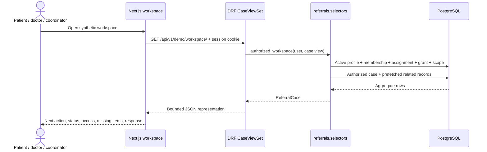
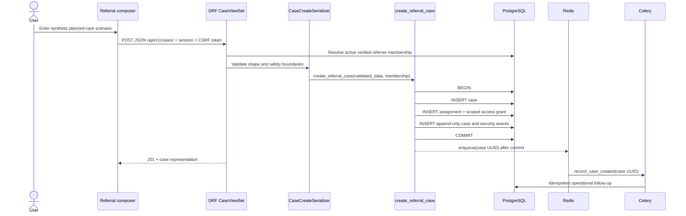

# Data Flow and Method Calls

## Read a case workspace



Expected call path:

```text
app/workspace/page.tsx
  -> lib/api.ts:getDemoWorkspace(cookie)
    -> GET /api/v1/demo/workspace/ + session cookie
      -> SessionAuthentication
      -> referrals.api.views.DemoWorkspaceView.get()
        -> referrals.selectors.get_authorized_demo_workspace(user, "case:view")
          -> identity state + membership + assignment + grant + scope filters
        -> referrals.selectors.referral_workspace_queryset()
          -> ReferralCase.objects.select_related(...).prefetch_related(...)
        -> referrals.api.serializers.ReferralCaseDetailSerializer
```

## Create a synthetic referral



Failure rules:

- Validation errors return field-specific `400` responses without echoing unsafe content into logs.
- A database failure rolls back case and initial event together.
- A broker failure after commit does not lose the referral; the durable case remains and a periodic reconciliation task can recover it.
- A rejected emergency-like scenario returns a coordination-boundary message and local-emergency direction. It is not categorized or stored.

## Deadline scan

```text
Celery beat (future scheduler)
  -> referrals.tasks.scan_referral_deadlines(batch_size)
    -> ReferralCase.objects.filter(next_action_due__lt=now, status__in=open_states)
      -> values_list("id", flat=True)[:bounded_batch]
        -> safe operational counter / future outbox notification
```

No task argument or queue payload contains patient name, clinical question, document name, or message content.

## Future secure upload flow — not implemented

```mermaid
sequenceDiagram
    actor User
    participant API
    participant DB
    participant Store as Private object quarantine
    participant Scan as Malware scanner

    User->>API: Request upload intent for authorized case/category
    API->>DB: Check identity + assignment + consent + category scope
    API-->>User: Short-lived restricted upload intent
    User->>Store: Upload directly to quarantine key
    Store-->>Scan: Object-created event
    Scan->>Store: Validate type, malware, safe metadata
    Scan->>API: Signed scan result callback
    API->>DB: Mark clean or rejected; append audit event
    API-->>User: Authorized short-lived view intent only after clean
```

This flow requires authentication, object-level permission evaluation, separate quarantine, content-type detection, malware scanning, safe preview generation, encryption/key policy, audit, retention, and incident response. Adding an S3 SDK alone is not an implementation of this design.

## Authorization decision flow — implemented for synthetic cases

```text
authenticated session
  -> active verified identity profile
  -> active organization and membership
  -> active case assignment in its valid interval
  -> active, unexpired, unrevoked case access grant
  -> normalized requested scope
  -> allow with append-only security event OR conceal case existence
```

Every condition is conjunctive. A verified doctor or hospital membership alone never grants case access. Consent and document-category scope remain future mandatory gates before real data.
