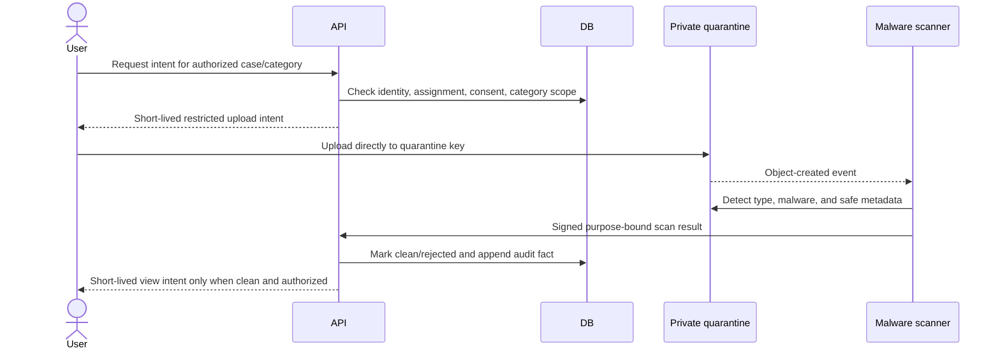

# Data Flow and Method Calls

## Browser sign-in

```mermaid
sequenceDiagram
    actor Doctor
    participant Form as LoginForm
    participant Next as Next.js same-origin rewrite
    participant API as DRF auth views
    participant DB as PostgreSQL sessions/identity

    Doctor->>Form: Submit email/username and password
    Form->>Next: GET /api/backend/auth/csrf
    Next->>API: GET /api/v1/auth/csrf/
    API-->>Form: Masked token + HTTP-only CSRF cookie
    Form->>Next: POST /api/backend/auth/login + token + cookie
    Next->>API: POST /api/v1/auth/login/
    API->>DB: Authenticate hash; require active verified profile
    API->>DB: Rotate/create server session; append safe login event
    API-->>Form: Session payload + HTTP-only session cookie
    Form-->>Doctor: Admin lab, doctor network, or workspace
```

Call path:

```text
components/login-form.tsx:handleSubmit()
  -> lib/api.ts:loginWithPassword()
    -> getCsrfToken()
    -> Next rewrite /api/backend/auth/{endpoint}
      -> identity.api.views.LoginView.post()
        -> LoginSerializer
        -> normalize_login_email()
        -> django.contrib.auth.authenticate()
        -> active verified IdentityProfile query
        -> django.contrib.auth.login()
        -> record_security_event(LOGIN_SUCCEEDED)
        -> selectors.session_payload()
```

The frontend alias `admin` maps to the configured local admin email. The backend still authenticates the normal Django username/password hash. In prototype debug mode, CSRF trusts only `localhost` and `127.0.0.1` on `KND_FRONTEND_PORT`, unless an explicit allowlist is supplied.

## Load or delete demo data

```mermaid
sequenceDiagram
    actor Admin
    participant UI as AdminLabShell
    participant API as AdminLabFixtureView
    participant Service as demo_lab.services
    participant Files as Versioned JSON fixture
    participant DB as PostgreSQL

    Admin->>UI: Select Load demo data
    UI->>API: POST fixtures + session + CSRF
    API->>DB: Require active platform-admin membership
    API->>Service: load_demo_data()
    Service->>Files: Parse and validate manifest/collections/references
    Service->>DB: Lock platform namespace; idempotent transactional seed
    Service->>DB: Compare actual and expected counts
    API->>DB: Append allowlisted admin fixture event
    API-->>UI: loaded state and counts

    Admin->>UI: Select Delete demo data and confirm
    UI->>API: DELETE fixtures + exact phrase + CSRF
    API->>Service: delete_demo_data()
    Service->>DB: Lock namespace; resolve fixture-owned keys
    Service->>DB: Delete dependencies then fixture accounts/organizations
    Service->>DB: Preserve persistent admin
    API-->>UI: empty state and removal summary
```

Expected call path:

```text
components/admin-lab-shell.tsx
  -> lib/api.ts:loadDemoFixtures() | deleteDemoFixtures()
    -> demo_lab.api.views.AdminLabFixtureView.post() | delete()
      -> IsPlatformAdmin
      -> FixtureDeleteSerializer (delete only)
      -> demo_lab.services.load_demo_data() | delete_demo_data()
        -> fixtures.load_product_demo_fixture()
        -> select_for_update(platform organization)
        -> seed_product_demo command | dependency-ordered deletion
      -> identity.services.record_security_event(...)
```

Patient fixture records are available only through the admin views. The professional directory reads a distinct bounded profile model and anonymous visitors receive neither dataset.

## Discover and connect with a doctor

```mermaid
sequenceDiagram
    actor Referrer
    participant UI as NetworkShell
    participant API as Professional network views
    participant Selector as network selectors
    participant Service as network services
    participant DB as PostgreSQL

    Referrer->>UI: Search specialty, doctor, city, or hospital
    UI->>API: GET /network/doctors/?search=...
    API->>DB: Require eligible active professional profile
    API->>DB: Filter discoverable synthetic cards; aggregate rating categories
    API-->>UI: Bounded professional cards only
    Referrer->>UI: Choose purpose and send request
    UI->>API: POST /network/connections/ + CSRF
    API->>Service: request_connection(actor=session user, command)
    Service->>DB: Reject self/duplicate; create canonical pending pair
    Service->>DB: Append safe connection event
    API-->>UI: Participant-shaped pending connection
```

Call path:

```text
app/network/page.tsx
  -> lib/api.ts:getProfessionalNetwork(cookie)
  -> components/network/network-shell.tsx
    -> searchProfessionalDirectory(params)
      -> ProfessionalDirectoryListView.get_queryset()
    -> createProfessionalConnection(payload)
      -> ConnectionListCreateView.post()
        -> ConnectionRequestSerializer
        -> services.request_connection(actor, ConnectionRequestCommand)
```

Directory output excludes login email, patient fixtures, admin metrics, raw credentials, and private application fields. Ratings are fictional peer-collaboration signals, not clinical quality.

## Accept a connection and message

```mermaid
sequenceDiagram
    actor Specialist
    participant UI as NetworkShell
    participant API as Connection/Conversation views
    participant Service as network services
    participant DB as PostgreSQL

    Specialist->>API: POST connection/{id}/accept/ + CSRF
    API->>Service: transition_connection(actor, id, accept)
    Service->>DB: Lock connection; require pending + recipient actor
    Service->>DB: Mark accepted; create one conversation atomically
    API-->>UI: Accepted participant-shaped connection
    Specialist->>API: POST conversation/{id}/messages/ + CSRF
    API->>DB: Resolve conversation from participant-only queryset
    API->>Service: append_message(actor, conversation, body)
    Service->>DB: Recheck accepted participation; append message
    Service->>DB: Append safe event without message body
    API-->>UI: Message with server-derived sender and viewer context
```

Only the recipient may accept/decline; only the requester may withdraw. A non-participant receives a concealed denial and cannot infer conversation contents. The prototype rejects common patient identifiers and direct-contact patterns and requires fictional-content confirmation, but these lexical guards are not a substitute for DLP or moderation.

## Create a synthetic referral

```mermaid
sequenceDiagram
    actor Referrer
    participant Form as ReferralComposer
    participant API as ReferralCaseViewSet
    participant Serializer as CaseCreateSerializer
    participant Service as create_referral_case
    participant DB as PostgreSQL
    participant Queue as Redis
    participant Worker as Celery

    Referrer->>Form: Enter invented planned-care scenario
    Form->>API: POST /cases/ + session + CSRF
    API->>DB: Resolve active verified referrer membership
    API->>Serializer: Validate shape and safety boundaries
    Serializer->>Service: create_referral_case(validated data, membership)
    Service->>DB: BEGIN; lock membership
    Service->>DB: Insert case, assignment, grant/scopes, participant, events
    Service->>DB: COMMIT
    Service-->>Queue: Enqueue case UUID after commit
    API-->>Form: 201 + bounded case representation
    Queue->>Worker: record_case_created(case UUID)
    Worker->>DB: Idempotent operational follow-up
```

Failure rules:

- Invalid fields return bounded `400` details without request-body logging.
- Emergency-like wording returns a coordination-boundary message and is not stored or clinically categorized.
- A database failure rolls back the aggregate and initial events together.
- A broker failure after commit cannot erase the durable case; reconciliation can retry by UUID.

## Read a referral workspace

```text
app/workspace/page.tsx
  -> lib/server-cookies.ts:getServerCookieHeader()
  -> lib/api.ts:getDemoWorkspace(cookie)
    -> GET /api/v1/demo/workspace/ + session cookie
      -> SessionAuthentication + HasActiveIdentity
      -> referrals.api.views.DemoWorkspaceView.get()
        -> selectors.get_demo_workspace()
        -> selectors.authorized_referral_workspace_queryset(user, case:view)
          -> active profile + organization + membership
          -> active assignment + grant + expiry/revocation + scope
        -> selectors.referral_workspace_queryset()
          -> select_related/prefetch_related aggregate
        -> ReferralCaseDetailSerializer
```

An unauthorized case is concealed as `404`. Knowledge of a UUID/reference, professional role, organization, or participant row is never sufficient.

## Submit a partner application

```text
components/registration/partner-application-form.tsx
  -> lib/api.ts:submitPartnerApplication(payload)
    -> POST /api/v1/onboarding/applications/
      -> PartnerApplicationCreateView.post()
        -> PartnerApplicationSerializer
          -> shared fields + DoctorDetailsSerializer | HospitalDetailsSerializer
          -> .test email / SYN-* registration / .example website guards
        -> services.submit_partner_application(validated_data)
          -> validate_password()
          -> atomic inactive User + IdentityProfile + application/detail
        -> generic 202 accepted response
```

Submission proves neither email ownership nor professional credentials and grants no network/case access. Reviewer activation and publication are not implemented.

## Deadline scan

```text
Celery beat every five minutes
  -> referrals.tasks.scan_referral_deadlines(batch_size=100)
    -> indexed open-case due-date query
      -> values_list("id", flat=True)[:bounded batch]
        -> safe operational count / future outbox work
```

Queue payloads and worker logs contain opaque IDs only—never names, message bodies, clinical questions, document labels, or credentials.

## Future secure upload — not implemented



An S3 SDK alone does not implement this flow. Quarantine, scan, immutable original, preview isolation, encryption/key policy, authorization, audit, retention, deletion/restriction, and incident response are all mandatory.
