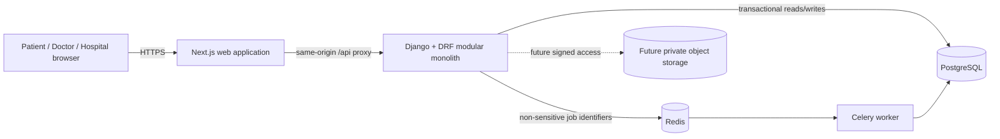

# High-Level Design

## Purpose

Knock Knock Doc is a consent-led cross-border healthcare referral network. Prototype V0 demonstrates one closed-loop referral journey using synthetic data. It coordinates work; it does not diagnose, prescribe, rank clinicians, promise outcomes, or handle emergencies.

## Architecture style

The system is a **modular monolith**: independently understandable domain modules live in one Django codebase, use one transactional PostgreSQL database, and are deployed together. This gives the first team strong consistency and low operating overhead while keeping boundaries clear enough to extract a service only after scale or ownership proves that necessary.

## Domain modules

| Module | Responsibility | Does not own |
|---|---|---|
| `core` | Health, base models, request/security utilities | Referral business rules |
| `referrals` | Cases, participants, access summaries, record metadata, information requests, responses, timeline, decisions | Identity verification or hospital billing |
| `notifications` (future) | Purpose-limited email/SMS delivery | Clinical content or access decisions |
| `identity` (future gate) | Authentication, organizations, memberships, role and assignment policy | Patient consent decisions |
| `records` (future gate) | Encrypted object metadata, scan status, derived previews, retention | Open public uploads |
| `audit` (future gate) | Immutable access and security events | Mutable operational notes |

V0 implements `core` and `referrals`. Future modules are named now to prevent uploads or role checks from being improvised inside view code.

## Primary user experience

The workspace is designed around five patient-safe questions:

1. What is this referral asking?
2. Who has access and why?
3. What information is missing?
4. What attributable response exists?
5. Who must act next, and by when?

The visual language is calm and clinical without looking institutional: warm white surfaces, deep teal text, restrained blue actions, generous spacing, plain language, and highly visible ownership. Colour never carries status alone. The design targets WCAG 2.2 AA contrast, keyboard navigation, visible focus, semantic headings, reduced-motion support, 44px touch targets, and responsive reflow.

## Deployment view

### Local and prototype

- Next.js Node container
- Django/Gunicorn API container
- Celery worker container
- PostgreSQL container
- Redis container

### Future managed production — decision not yet made

- Container runtime behind a managed load balancer and WAF
- Managed PostgreSQL such as AWS RDS with encryption, private networking, PITR, and tested restore
- Managed Redis compatible queue with TLS and private networking
- Private S3-compatible bucket with KMS keys, public access blocked, malware quarantine, lifecycle policy, and short-lived signed access
- Central secrets, audit logging, metrics, tracing, and alerting

AWS is an option, not a V0 dependency. An architecture decision record is required before selection.

## Key design decisions

1. **Synthetic-only until authorization exists.** Anonymous APIs and real health data cannot safely coexist.
2. **No native file upload yet.** Document rows in V0 are presentation metadata for rehearsal.
3. **API versioning from day one.** Public application endpoints live under `/api/v1/`.
4. **Service layer for commands.** HTTP serializers validate transport; services enforce transitions and transaction boundaries.
5. **Asynchronous work is supplementary.** The request transaction creates the durable fact; Celery processes idempotent follow-up work by opaque UUID.
6. **No microservices in V0.** A database transaction is more valuable than premature distributed boundaries.
7. **No medical automation.** Completeness and clinical decisions remain attributable to humans.

## Release boundaries

Prototype V0 can demonstrate usability and workflow. It cannot be opened to real patients until authentication, object- and document-level authorization, reviewed consent, secure uploads, audit evidence, identity/credential verification, incident response, retention, jurisdictional review, and role-isolation tests are complete.
