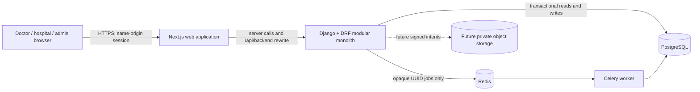

# High-Level Design

## Product purpose

Knock Knock Doc is a doctor-first professional network that turns a trusted peer relationship into a controlled referral workflow. The primary journey is:

`discover a doctor → compare relevant collaboration signals → connect for a stated purpose → discuss without patient data → create an authorized referral case`

The prototype coordinates planned cross-border care. It does not diagnose, prescribe, triage emergencies, verify real credentials, rank clinical quality, guarantee outcomes, or hold real health records.

## Architecture style

The backend is a **modular monolith**: domain modules live in one Django deployment and one transactional PostgreSQL database. This preserves strong consistency and low operational overhead for a small team while keeping module boundaries explicit enough to extract only when measured scaling, security isolation, or team ownership requires it.



## Product surfaces

```text
Public website
├── Home
├── Doctors
├── Hospitals
├── How it works
├── Blogs
├── About
├── Join
│   ├── Doctor application
│   └── Hospital application
└── Sign in

Authenticated doctor product
├── Discover
├── My network
├── Messages
└── Referrals

Platform administration
└── Demo data lab
    ├── Load/delete fixture
    ├── 30 fictional doctors
    └── 30 fictional patients
```

Public Doctors and Hospitals are currently honest product gateways rather than a publication of synthetic admin records. Anonymous visitors never receive fixture profiles. Provider publication needs a separate verified publication read model and review process before real launch.

## Domain modules

| Module | Owns | Boundary |
|---|---|---|
| `core` | Health response, common UUID/timestamp base, security middleware, safe exceptions | No referral or identity rules |
| `identity` | Sessions, profiles, organizations, memberships, account state, security events | Membership alone never grants a case or conversation |
| `professional_network` | Bounded professional cards, collaboration ratings, connections, conversations, append-only messages | Professional messages cannot contain patient-specific work |
| `partner_onboarding` | Doctor/hospital applications, subtype details, acknowledgements, review state | Submission creates an inactive applicant, not professional privileges |
| `referrals` | Cases, assignments, scoped grants, records metadata, requests, responses, timeline | Case access is assignment-and-grant specific |
| `demo_lab` | Versioned JSON fixture loading/deletion and admin-only full catalogs | Patient fixtures and operational fields never enter public/network APIs |
| `records` (future) | Private object metadata, quarantine/scan state, versions, retention | No public file URLs or upload before release gates |
| `audit` (future) | Immutable access evidence and privileged operations | Operational notes are not audit evidence |

## Identity and authorization

Django owns password hashing and server-side sessions. The browser stores only HTTP-only cookies and sends a masked CSRF token for unsafe requests; it never stores a bearer token.

A synthetic referral read is allowed only when all conditions are current:

1. user and identity profile are active;
2. the prototype email is marked verified;
3. organization and exact membership are active;
4. that membership has an active assignment to the case;
5. its grant is active, unexpired, and unrevoked; and
6. the normalized grant includes the requested scope.

Professional discovery additionally requires an eligible active professional identity. Connection and conversation records are queried by participant membership; sender and requester identities are always derived from the session.

Partner applications are deliberately separate from authorization. A submitted doctor or hospital application leaves the account inactive pending review. Email control, credential verification, application approval, organization membership, discoverability, and publication are different facts.

## Demo fixture lifecycle

The application bootstraps only the persistent local platform administrator. It does not auto-seed product data.

The administrator explicitly loads a validated, versioned JSON fixture. The transaction creates organizations, accounts, 30 doctor profiles, 30 patient profiles, bounded directory cards, fictional collaboration ratings, connections, conversations, and a referral workspace. The delete operation removes fixture-owned records in dependency order while retaining the administrator and producing an allowlisted security event.

The local `admin` / `admin` convenience credential is an explicit loopback-only development exception. It requires prototype mode, Django debug mode, and a dedicated opt-in flag. Startup fails if the flag is enabled outside that boundary. Strong password validation remains the default.

## User-experience principles

- Design for a referring doctor first; patient/family content is secondary public education.
- Use task labels—Discover, My network, Messages, Referrals—not architecture vocabulary.
- Keep one clear primary action per page and disclose synthetic-only limits near consequential actions.
- Use warm white surfaces, dark teal text, restrained blue/teal actions, readable system fonts, and generous spacing.
- Target WCAG 2.2 AA fundamentals: semantic structure, keyboard operation, visible focus, 44px controls, reduced motion, zoom/reflow, and status meaning beyond colour.
- Ratings describe fictional peer communication, collaboration, and handback reliability; they never imply treatment quality or clinical outcomes.

## Deployment view

### Local prototype

- Next.js standalone Node container
- Django/Gunicorn API container
- Celery worker container
- PostgreSQL container
- Redis container
- loopback-bound frontend and API ports; database and queue stay inside the private Compose network

### Future managed deployment — undecided

- Container runtime behind managed load balancing and a WAF
- Managed PostgreSQL such as AWS RDS with encryption, private networking, PITR, and restore proof
- TLS/private managed Redis-compatible queue
- Private S3-compatible object storage with KMS, blocked public access, quarantine, malware scanning, lifecycle policy, and short-lived signed intents
- Central secret management, audited operations, metrics, traces, alerts, and security response

AWS is an option, not a current dependency. Selection requires an architecture decision record based on residency, recovery, integrations, workload, procurement, and cost evidence.

## Key decisions

1. **Doctor-first network, referral as the value unit.** Profiles and chat exist to establish professional trust; patient-specific work moves into a scoped case.
2. **Synthetic-only even with authentication.** Session auth is necessary but does not authorize real health data.
3. **No public synthetic provider shortcut.** Admin fixtures remain private; public publication needs verified, reviewed read models.
4. **Service-layer commands.** Serializers validate transport; services own transitions and transactions; selectors own authorization-shaped reads.
5. **Append-only material facts.** Case events, security events, and professional messages are attributable and not edited in place.
6. **Durable fact before background work.** The request transaction commits first; Celery receives opaque identifiers after commit.
7. **HTTP polling before WebSockets.** Real-time infrastructure is deferred until messaging demand and operational requirements are measured.
8. **No native file upload.** Current record rows are fictional metadata only.
9. **No microservices in V0.** A transactional monolith is safer and simpler than premature distributed boundaries.

## Release boundary

The prototype can demonstrate comprehension, professional discovery, connection, messaging, fixture administration, and scoped referral access. It cannot accept real people or health data until every stop gate in [Performance and Security](PERFORMANCE_AND_SECURITY.md) is implemented, independently tested, and approved for the chosen corridor.
