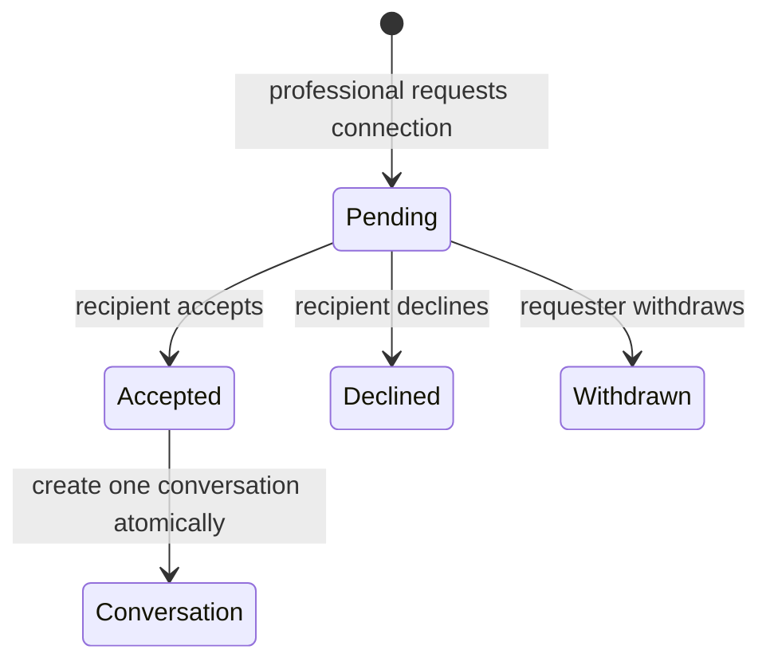

# Low-Level Design

## Repository layout

```text
backend/
  config/                       Settings, URL routing, ASGI/WSGI, Celery
  apps/core/                    Shared model base, health, middleware, exceptions
  apps/identity/                Sessions, profiles, organizations, memberships, events
  apps/partner_onboarding/      Doctor/hospital application aggregate
  apps/professional_network/    Directory, ratings, connections, conversations, messages
  apps/referrals/               Referral aggregate, authorization, services, tasks
  apps/demo_lab/                Validated fixture loader and admin-only API
  fixtures/product_demo/v1/     Versioned credential-free JSON collections
  manage.py
frontend/
  app/                          Next.js App Router pages and metadata
  components/                   Product, network, admin, registration, referral UI
  content/blog/                 Validated reusable article JSON
  lib/                          Typed API client, content loader, contracts
  styles/                       Route/component CSS modules
  public/images/                Local editorial and interface assets
docs/                           Product and engineering documentation
openspec/                       Proposals, specs, designs, adversarial reviews, tasks
worklog/                        Numbered append-only Markdown history
business/                       Local ignored founder analysis
```

Tailwind CSS v4 supplies the CSS pipeline/base layer. New route systems use CSS Modules; the original V0 workspace and shared tokens still use `app/globals.css` and should be migrated incrementally without visual regressions.

## Identity model

The project retains Django's migrated default `User`. Login usernames are normalized lowercase emails; the frontend maps the explicit local alias `admin` to the configured demo-admin email.

| Entity | Key responsibility | Invariant |
|---|---|---|
| `IdentityProfile` | Display identity, normalized email, account type, verification basis/account state | One per user; normalized email unique; `unverified` cannot authorize access |
| `Organization` | Platform, hospital, or referring-practice boundary | Suspended organization cannot authorize membership |
| `OrganizationMembership` | Explicit role for a user in one organization | Only active membership participates in authorization |
| `SecurityEvent` | Authentication, access, admin fixture, and network evidence | Append-only; allowlisted metadata only |

Passwords use Django hashers and validators. Partner submission creates an inactive user plus private application aggregate. It does not create an identity profile, active organization membership, or discoverable professional profile until a valid reviewer approval transaction succeeds.

## Professional network aggregate

| Entity | Important fields | Invariant |
|---|---|---|
| `ProfessionalDirectoryProfile` | User, role, specialty, experience, country/city, organization, languages, summary, avatar key, verification/discoverability | V0 row is synthetic; one card per user |
| `ProfessionalRating` | Reviewer, subject, communication/collaboration/handback scores, bounded comment | Scores 1–5; unique reviewer/subject; synthetic only |
| `ProfessionalConnection` | Requester, recipient, canonical pair key, purpose, note, state, response time | Distinct users; one unordered pair; actor-specific transitions |
| `ProfessionalConversation` | One-to-one accepted connection | Created only on acceptance |
| `ProfessionalMessage` | Conversation, server-derived sender, bounded body, timestamp | Append-only; participant-only; no attachments |

Connection state machine:



Service rules:

- `request_connection()` locks/validates the actor, rejects self/duplicate pairs, derives requester, creates the pending row, and records a safe event.
- `transition_connection()` locks the row, authorizes the requester or recipient for that action, persists the terminal state, and creates the conversation only for acceptance.
- `append_message()` verifies accepted connection and exact participation, rejects sensitive/direct-contact patterns, derives the sender, and appends one message.
- Directory, connection, and conversation selectors always start from the active session user; the client cannot submit an actor ID.

HTTP polling is intentional for V0. WebSockets remain deferred until delivery semantics, authorization refresh, blocking/reporting, presence, scale, and measured user need are defined.

## Referral aggregate

`ReferralCase` is the aggregate root. Related records cannot exist without a case.

| Entity | Key fields | Invariant |
|---|---|---|
| `ReferralCase` | UUID, reference, specialty, fictional summary/question, status, consent state, next action/owner/date | V0 is synthetic and planned-care confirmed |
| `CaseAssignment` | Case, exact organization membership, purpose, active interval | Role or organization alone is insufficient |
| `CaseAccessGrant` | Case, assignment/membership, issue/revoke/expiry facts | One current grant per case membership; history retained |
| `GrantScope` | Grant, normalized scope | Unique within a grant |
| `CaseParticipant` | Case presentation identity and access label | Presentation row does not authorize access |
| `RecordItem` | Fictional metadata label, category, source, readiness | No object URL or file payload |
| `InformationRequest` | Requested item, requester, reason, state, date | Attribution required |
| `ProviderResponse` | Author, organization, type, summary, limitations, date | Clinical and commercial authorship remain separate |
| `CaseEvent` | Event type, safe actor label/role, bounded summary, time | Append-only through application services |

Case list/detail selectors require the conjunction of active identity, organization, membership, assignment interval, grant state/expiry, and requested scope. Inaccessible UUIDs return `404` to conceal existence.

Create-case command:

1. DRF session authentication resolves an active verified referrer membership.
2. Serializer validates shape, enums, lengths, planned-care confirmation, emergency wording, and fictional patient label.
3. `create_referral_case()` opens a transaction and locks the current membership.
4. It creates the case, assignment, scoped grant, participant, and initial append-only events atomically.
5. `transaction.on_commit()` enqueues only the case UUID.
6. Celery performs idempotent operational follow-up without logging clinical text.

The emergency phrase check is a product-boundary guard, not medical triage.

## Partner application aggregate

`PartnerApplication` owns immutable submission facts and exactly one subtype detail row (`DoctorApplicationDetails` or `HospitalApplicationDetails`).

V0 request rules:

- JSON only; bounded field/list lengths.
- `.test` email required, normalized before lookup.
- minimum 14-character password plus Django validators.
- fictional doctor registration begins `SYN-`.
- hospital website is under `.example`.
- current terms version and synthetic-only acknowledgement are mandatory.
- generic accepted response avoids revealing whether an account already exists.
- transaction creates an inactive account/profile and application.

The private admin queue lists only minimal summary fields. Opening one application performs a separate audited detail read. Review services lock both demo mode and the application row, derive the reviewer from the session, enforce the state machine, and keep free-text reviewer notes out of security-event metadata. Request-changes and rejection require an allowlisted reason code.

Synthetic approval requires prototype mode, `is_synthetic=true`, and a `.test` email. Doctor approval creates an active identity with `synthetic_admin_review`, one dedicated organization, one role-specific membership, and one synthetic directory card. Hospital approval creates the active identity, hospital organization, and hospital-coordinator membership but no directory card. Both leave every referral assignment and grant empty. Resume-safe drafts, hashed email-verification tokens, real evidence files, public publication, appeals, and reverification remain future gates.

## Demo fixture contract

`fixtures/product_demo/v1/manifest.json` declares fixture identity, schema version, disclosure, filenames, and expected counts. `load_product_demo_fixture()`:

1. reads only known local files;
2. validates collection shapes and exact expected counts;
3. validates cross-file references;
4. recursively rejects secret-like keys; and
5. returns a typed in-memory fixture contract.

`load_demo_data()` acquires a database lock on the persistent platform organization and runs the idempotent seed command inside a transaction. It verifies actual counts against the manifest before reporting `loaded`.

`delete_demo_data()` resolves records only through fixture keys/emails, removes dependent messages/conversations/connections/ratings/grants/assignments first, then profiles/accounts and unused fixture organizations. The platform administrator is not part of the fixture participant set and survives deletion.

The API requires a platform-admin membership for summary, list, load, and delete. Delete additionally requires the exact confirmation phrase `DELETE SYNTHETIC DEMO DATA`.

## API contract

| Method and path | Permission |
|---|---|
| `GET /api/v1/health/` | Anonymous, throttled |
| `GET /api/v1/auth/csrf/` | Anonymous, throttled |
| `POST /api/v1/auth/login/` | Anonymous, CSRF, login throttle |
| `GET /api/v1/auth/session/` | Authenticated active identity |
| `POST /api/v1/auth/logout/` | Authenticated active identity, CSRF |
| `POST /api/v1/onboarding/applications/` | Anonymous, throttled, fictional-only |
| `GET /api/v1/onboarding/review/applications/` | Platform admin; minimal summary page |
| `GET /api/v1/onboarding/review/applications/{id}/` | Platform admin; audited private detail |
| `POST /api/v1/onboarding/review/applications/{id}/{action}/` | Platform admin; CSRF, throttle, row-locked transition |
| `GET /api/v1/network/doctors/` | Eligible verified professional |
| `GET/POST /api/v1/network/connections/` | Eligible professional; participant-shaped read |
| `POST /api/v1/network/connections/{id}/{action}/` | Action-specific requester/recipient permission |
| `GET /api/v1/network/conversations/` | Participant-only |
| `GET/POST /api/v1/network/conversations/{id}/messages/` | Accepted participant-only; CSRF on write |
| `GET/POST /api/v1/cases/` | Authorized read / active verified referrer write |
| `GET /api/v1/cases/{id}/` | Scoped case grant or concealed `404` |
| `GET /api/v1/demo/workspace/` | Scoped case grant |
| `GET /api/v1/admin/lab/summary/` | Platform admin |
| `POST/DELETE /api/v1/admin/lab/fixtures/` | Platform admin, CSRF, mutation throttle |
| `GET /api/v1/admin/lab/doctors/` | Platform admin |
| `GET /api/v1/admin/lab/patients/` | Platform admin |

All unsafe session requests require Django CSRF validation. Prototype debug mode derives trusted origins only for `localhost` and `127.0.0.1` on `KND_FRONTEND_PORT`; a deployment can supply an explicit allowlist. Request bodies, pages, text, and task batches are bounded.

## Frontend structure

- Server route components own metadata, session checks, redirects, and initial data reads.
- Client components are limited to authentication, application steps, network interactions, admin fixture mutations, referral composition, and workspace tabs.
- `lib/api.ts` centralizes typed same-origin requests, CSRF acquisition, response errors, and server API calls.
- `lib/blog.ts` validates file-backed article content once and powers listing, home cards, and slug pages.
- Protected routes redirect unauthenticated users to `/login`; admin and professional routes also render explicit role-denial states.
- Public navigation uses the exact labels `Doctors`, `Hospitals`, `How it works`, `Blogs`, `About`, `Join`, and `Sign in`.
- No patient-sensitive value enters URLs, analytics, local storage, or session storage.

## Database and task behavior

- PostgreSQL owns runtime constraints and indexes; SQLite is for fast explicit tests only.
- UUIDs reduce enumeration but never replace authorization.
- `select_related()` / `prefetch_related()` bound aggregate reads and avoid N+1 behavior.
- Mutating services use `transaction.atomic()` and row locks where competing transitions matter.
- Celery tasks accept UUID strings only, use finite retry/backoff, and avoid free-text logs.
- Deadline scans read indexed due dates in bounded batches.

## Future private storage interface

If real records are authorized later, domain code will depend on `create_upload_intent`, `finalize_after_scan`, `create_view_intent`, and `restrict_object`. A private S3-compatible adapter may implement those operations, but PostgreSQL remains authoritative for consent scope, scan state, grants, retention, and audit. Public bucket URLs are forbidden.
