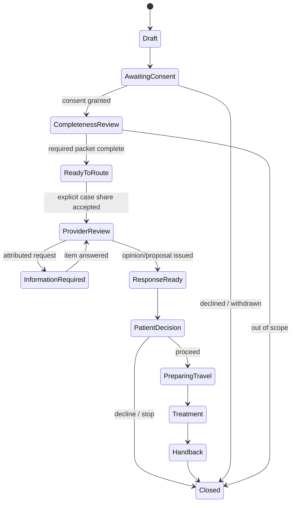

# Low-Level Design

## Repository layout

```text
backend/
  config/                 Django settings, URL routing, Celery wiring
  apps/core/              Shared UUID/timestamp model and health endpoint
  apps/referrals/         Referral aggregate, API, services, tasks, tests
  manage.py
frontend/
  app/                    Next.js App Router routes and global styles
  components/             Accessible product and workspace components
  lib/                    Typed API client and domain contracts
infra/                    Container entry points when needed
docs/                     Product and engineering documentation
worklog/                  Numbered immutable Markdown entries
```

## Referral aggregate

`ReferralCase` is the aggregate root. Related records cannot exist without a case.

| Entity | Key fields | Important invariant |
|---|---|---|
| `ReferralCase` | UUID, human reference, specialty, sourced summary, clinical question, status, consent status, next action/owner/due date | V0 rows are always marked synthetic; planned care must be confirmed |
| `CaseParticipant` | case, display name, role, organization, access scope/state | Unique active presentation identity per case/role/name |
| `RecordItem` | case, label, category, clinical date, source, readiness state | Metadata only in V0; never contains an object URL or raw file |
| `InformationRequest` | case, requested item, requester, reason, state, due date | Requester and reason are attributable |
| `ProviderResponse` | case, author, organization, response type, summary, limitations, issued time | Clinical and commercial authorship remain separate |
| `CaseEvent` | case, event type, actor label/role, safe summary, occurred time | Append-only through application services |

All identifiers exposed outside the service are UUIDs or non-sequential references. Human references are not authorization tokens.

## Case state model



V0 displays these stages but exposes only the safe creation command. Later mutation endpoints must use an explicit transition function with actor, preconditions, event creation, and `select_for_update()`.

## API contract

| Method and path | Purpose | V0 access |
|---|---|---|
| `GET /api/v1/health/` | Liveness/readiness summary without secrets | Anonymous |
| `GET /api/v1/cases/` | Synthetic rehearsal case list | Anonymous, throttled |
| `POST /api/v1/cases/` | Create a synthetic planned-care referral rehearsal | Anonymous, throttled, JSON only |
| `GET /api/v1/cases/{uuid}/` | Complete synthetic case workspace | Anonymous, throttled |
| `GET /api/v1/demo/workspace/` | Stable seeded workspace for the frontend | Anonymous, throttled |

The API never returns stack traces, environment variables, database details, storage paths, or raw exception text. V0 parsers accept JSON only. Request size and list/page sizes are bounded.

## Create-case command

1. DRF validates length, enum, date, and planned-care confirmation.
2. Serializer rejects emergency wording and likely direct identifiers in the synthetic patient label.
3. `create_referral_case()` opens a database transaction.
4. A `ReferralCase` and its initial `CaseEvent` are written atomically.
5. `transaction.on_commit()` sends only the case UUID to Celery.
6. The worker records operational metrics without logging clinical text.

The emergency keyword check is a prototype safety guard, not clinical triage. It redirects the user to local emergency services and must never claim to determine urgency.

## Database behavior

- PostgreSQL is the runtime database and owns constraints/indexes.
- UUID primary keys reduce enumeration risk but do not replace authorization.
- Case status, consent status, due date, and update time are indexed for queues.
- Related rows use explicit `PROTECT` or `CASCADE` according to aggregate ownership.
- Querysets for workspace responses use `select_related`/`prefetch_related` to bound query count.
- Migrations are committed and run before application start.
- SQLite is permitted only through `DATABASE_ENGINE=sqlite` for fast unit tests; PostgreSQL integration tests remain a release requirement.

## Frontend component model

- Server routes own metadata and initial data boundaries.
- Client components are limited to interactive role preview, tabs, and the referral composer.
- The typed API client validates response shape defensively and uses no credentials in browser storage.
- The role switch is labelled “prototype preview”; it changes presentation only and is never described as access control.
- Loading, empty, and unavailable states use plain language and a recoverable action.
- No patient-sensitive value appears in URLs, analytics, or browser persistence.

## Celery behavior

- Redis is broker/result transport for V0.
- Tasks accept UUIDs, not serialized models or health information.
- Tasks are idempotent and have finite retry/backoff policies.
- The periodic deadline scan reads indexed due dates in bounded batches.
- Worker logs include task and case IDs, never clinical questions, names, or documents.

## Future storage interface

When secure record upload is authorized, application code will depend on a storage service with `create_upload_intent`, `finalize_after_scan`, `create_view_intent`, and `restrict_object` operations. The adapter may use S3, but database rows remain authoritative for consent scope, scan state, retention, and audit. Direct public bucket URLs are forbidden.
